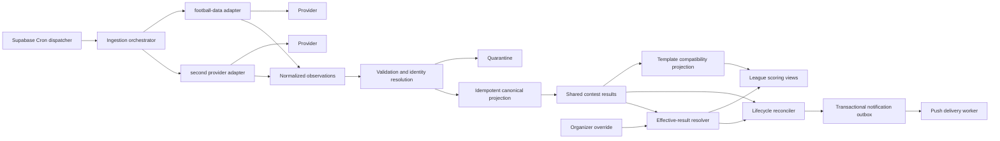

# Tournament and Event Ingestion Architecture Plan

**Date:** 2026-10-02
**Status:** Approved at G0 on 2026-10-03 — implementation remains slice-gated

## Executive decision

Build a durable ingestion module between external providers and Bracket.fyi's scoring tables. Adapters fetch and normalize provider observations; an orchestrator validates, deduplicates, maps identities, projects canonical results, reconciles league lifecycle, and writes durable notification intents. Provider adapters never write scoring tables directly.

Football-data.org is the first production adapter because its match lifecycle and winner semantics were proven in BoyzWC2026. The model is deliberately broader than soccer: a scored contest may be a game, match, multi-game series, two-leg tie, award category, or ceremony result.

## Current-state architecture

### Shipped modules

- Next.js 14 App Router on Vercel.
- Supabase Postgres, RLS, Realtime, and one Web Push Edge Function.
- `templates` define `bracket` or `pickem` shape, registry, schedule JSON, scoring defaults, and a free-text `results_provider`.
- `template_matches` represent every scoreable slot, including Oscars categories.
- `template_results` contain one shared winner per template match.
- `league_result_overrides` contain one organizer-selected winner per league and match.
- Scoring views derive scores and give league overrides precedence over shared results.
- `leagues.status` supports `active`, `locked`, and `complete`; only lock/unlock transitions are implemented.
- Manual organizer result entry writes only to `league_result_overrides`.
- Push subscriptions and a best-effort broadcast fan-out are deployed.

### Proven prior implementation

BoyzWC2026 demonstrated:

- football-data.org result polling;
- alias-aware team resolution;
- provider status normalization;
- authoritative winner use for extra time and penalties;
- manual override freeze behavior;
- five-minute match-window polling and six-hour idle polling;
- skip-and-report handling for ambiguous mappings;
- derived scoring parity against a real tournament;
- optional odds enrichment isolated from scoring.

The reusable lessons are valid. The old implementation is single-tournament, maps matches partly through participant picks, has no durable ingestion log or generic idempotency model, and calls notifications inline. It is reference evidence, not a module to copy wholesale.

## Known gaps and risks

| Area | Evidence-backed gap | Consequence |
|---|---|---|
| Ingestion | No provider adapter, scheduler, run log, or provider mapping exists in this repository | All live results are manual |
| Domain | `template_matches` assumes one flat scoreable row; no series, tie, child game, ceremony, or stage model | MLB and UCL aggregate ties cannot be represented faithfully |
| Identity | Competitors and aliases live in template JSON | No durable cross-event canonical IDs or provider mappings |
| Provenance | `template_results` stores only winner, score JSON, source enum, and timestamp | Corrections, raw evidence, provider revision, and stale state are unauditable |
| Overrides | Override has winner and timestamp only | No reason, actor, release, expiration, or history |
| Lifecycle | No completion reconciler exists; GitHub issue #3 is open | `locked` leagues never become `complete` automatically |
| Effective results | The `effective_results` view joins overrides without generating a row per league; filtering `league_id = ...` excludes base rows where no override exists | Consumers can miss shared results; scoring views work around the view independently |
| Security | `/api/admin/*` mutation routes use the service-role client but do not authenticate the organizer token; middleware protects `/l/*`, not `/api/*` | A caller who knows IDs can attempt privileged mutations |
| Notifications | Result notifications are not wired; broadcast uses fire-and-forget HTTP with no outbox or delivery ledger | Process termination can lose sends; duplicates are not durably prevented |
| Tests | No unit, integration, contract, or browser test runner is configured | Regression risk is high for schema and lifecycle changes |
| Operations | No provider health, freshness, quarantine, rate-budget, or scheduler dashboard exists | Failures can silently produce stale leaderboards |
| Plan compatibility | Supabase Free may pause inactive projects; [Vercel Hobby cron](https://vercel.com/docs/cron-jobs/usage-and-pricing) runs at most daily | Live event polling needs an explicitly verified runtime/plan |

The unauthenticated admin mutations are a release-blocking security finding and must be the first approved implementation slice, even though they predate ingestion.

## Target architecture



### Module seams

| Module | Interface responsibility | Implementation hidden behind it |
|---|---|---|
| Provider adapter | Fetch pages/windows; expose capabilities; classify provider errors; emit provider-neutral observations | Authentication headers, URLs, pagination, provider enums, response shape |
| Identity resolver | Resolve or quarantine external organizations, competitors, entries, contests, stages, and rounds | Alias matching, external-ID mappings, conflict thresholds |
| Ingestion orchestrator | Claim due bindings; enforce rate budget; execute adapter; persist observations and run outcome | Locks, retries, cursors, backoff, transaction grouping |
| Canonical projector | Convert validated observations into monotonic canonical state | Upsert ordering, correction rules, result versions, audit events |
| Effective-result resolver | Return the result that counts for one league and contest | Active override precedence, expiration/release, base-result fallback |
| Lifecycle reconciler | Compute legal league status from effective required results and holds | Completion counts, correction reopening, timestamps, transition audit |
| Notification outbox | Record deduplicated notification intents transactionally | Fan-out selection, retries, endpoint pruning, delivery audit |
| Template projector | Expose canonical contests/results to the existing pick/scoring modules | Compatibility mapping to `template_matches` and `template_results` |

The provider seam becomes stable only after football-data.org and a structurally different provider—recommended BALLDONTLIE NFL—both satisfy it.

## Canonical domain model

### Terms

- **Organization:** Governing or owning body, such as MLB, UEFA, FIFA, NFL, NCAA, a conference, club, school, studio, or Academy branch where relevant.
- **Competitor:** A selectable contender: team, national side, person, film, song, or creative work.
- **League participant:** Existing Bracket.fyi human who submits picks. It remains separate from an event competitor.
- **Competition:** Durable event family and rules identity, such as UEFA Champions League or Academy Awards.
- **Event edition:** One occurrence or season, such as UEFA Champions League 2026/27 or the 99th Academy Awards.
- **Stage:** Major phase such as league phase, Wild Card, knockout, nominations, or ceremony.
- **Round:** Ordered subdivision within a stage.
- **Contest:** Atomic decision that can produce a scored outcome. Kinds: `game`, `match`, `series`, `tie`, `award`, `category`.
- **Contest leg:** Child game/match under a series or aggregate tie.
- **Event entry:** A competitor's participation in an edition/contest, including seed, side, conference, region, or nominee role.
- **Bracket:** Advancement graph connecting contests.
- **Result:** Versioned, auditable outcome for a contest.
- **Ceremony:** Timed event edition or stage that resolves award/category contests.

### Proposed database additions

Names are proposed and require G1 approval.

| Table/module | Purpose and key invariants |
|---|---|
| `data_providers` | Provider identity, adapter key, terms URL, attribution text, enabled state |
| `competitions` | Durable event family, sport/domain, rules metadata |
| `event_editions` | Season/year, timezone, start/end, lifecycle, official URLs |
| `organizations` | Canonical governing/owning organizations |
| `competitors` | Canonical team/person/work with `kind` and stable internal ID |
| `competitor_aliases` | Normalized alias, locale, source, validity window; uniqueness scoped by domain/organization |
| `event_entries` | Competitor in an edition, with seed, region, conference, nomination metadata |
| `stages` and `rounds` | Ordered competition structure and advancement semantics |
| `contests` | Atomic or aggregate scored unit, parent contest, schedule, status, completion requirement |
| `contest_entries` | Contest sides/nominees and roles |
| `brackets` and `bracket_edges` | Advancement graph independent of provider ordering |
| `provider_bindings` | Event/provider/adapter configuration, credential reference, cursor, polling policy, stale threshold |
| `provider_entity_refs` | Provider external IDs mapped to canonical IDs by entity kind; reviewed state |
| `ingestion_runs` | Start/end, binding, trigger, cursor, counts, status, rate headers, error class |
| `provider_observations` | Immutable external identity, provider timestamp/version, received timestamp, payload hash, sanitized payload |
| `ingestion_quarantine` | Unresolved identity, conflict, illegal regression, partial payload, operator disposition |
| `contest_results` | Current canonical base result, version, status, winner, scores, source observation |
| `result_audit_events` | Append-only history for provider changes, corrections, overrides, releases, and lifecycle effects |
| `notification_outbox` and `notification_attempts` | Durable, deduplicated intents and per-endpoint delivery outcomes |
| `league_completion_holds` | Optional organizer hold delaying `complete` while required results are present |

Compatibility changes:

- Add nullable `event_edition_id` to `templates`.
- Add nullable `contest_id` and `counts_toward_completion` to `template_matches`.
- Keep current rows and IDs stable during migration.
- Initially project accepted canonical results into `template_results`; later replace duplicated result reads with an effective-result database function/view that takes `league_id` explicitly.
- Extend or replace `league_result_overrides` with status, actor, reason, expiry/release, result payload, and audit linkage without dropping existing data.

## Common provider adapter interface

Illustrative TypeScript; final names require G0/G1 approval.

```ts
type ProviderCapability =
  | "schedule"
  | "live_status"
  | "final_results"
  | "bracket_structure"
  | "series"
  | "aggregate_ties"
  | "nominations"
  | "ceremony_results";

interface ProviderAdapter {
  readonly key: string;
  capabilities(binding: ProviderBinding): ReadonlySet<ProviderCapability>;
  pull(context: PullContext): Promise<ProviderPage>;
  normalize(page: ProviderPage, context: NormalizeContext): NormalizedObservation[];
  classifyError(error: unknown): ProviderFailure;
}

interface PullContext {
  binding: ProviderBinding;
  windowStart: string;
  windowEnd: string;
  cursor?: string;
  etag?: string;
  credential: ProviderCredential;
}

interface NormalizedObservation {
  externalId: string;
  entityKind: "edition" | "stage" | "round" | "contest" | "competitor" | "result";
  providerUpdatedAt?: string;
  observedAt: string;
  payloadHash: string;
  data: NormalizedEntity;
  completeness: "full" | "partial";
}
```

Adapter rules:

- No database writes, scoring, league lookup, push, or organizer-override logic.
- Provider payloads do not leak into frontend types.
- Missing fields stay unknown; adapters do not invent winners, rounds, or identities.
- Every adapter ships sanitized recorded fixtures and contract tests.
- Provider-specific configuration is schema-validated and versioned.

## Event configuration model

Configuration belongs to an `event_edition`, not code branches:

```json
{
  "eventEdition": "uefa-cl-2026-27",
  "providerBinding": {
    "provider": "football-data",
    "competitionExternalId": "CL",
    "adapterConfigVersion": 1,
    "credentialRef": "football_data_token"
  },
  "structure": {
    "scoringContestKinds": ["tie", "match"],
    "includeStages": ["KNOCKOUT_PLAYOFFS", "LAST_16", "QUARTER_FINALS", "SEMI_FINALS", "FINAL"],
    "completionPolicy": "all_required_contests_final"
  },
  "pollingPolicy": {
    "idleSeconds": 21600,
    "pregameSeconds": 900,
    "liveSeconds": 120,
    "postgameSeconds": 300,
    "staleAfterSeconds": 900
  }
}
```

Configuration includes allowed stages, time zone, lock policy, scoring contests, status map, tie/series aggregation, poll windows, stale thresholds, attribution, and fallback mode. Credentials are referenced, never embedded.

## Normalization rules

### Organizations, teams, competitors, and participants

1. Provider external ID mapping is authoritative once reviewed.
2. Exact normalized alias matching may propose a mapping; it cannot overwrite a conflicting reviewed mapping.
3. Fuzzy name matching is advisory only and enters quarantine below the approval threshold.
4. Names normalize Unicode, whitespace, punctuation variants, known abbreviations, locale, and historical validity; display names remain unchanged.
5. Team franchises, national sides, schools, people, films, and songs are competitors with explicit kinds—not overloaded strings.
6. Existing Bracket.fyi `participants` remain human league participants and are never merged with event competitors.

### Tournaments, leagues, stages, rounds, and brackets

1. A competition is stable across years; an event edition carries dates and participants.
2. Provider “league” terminology maps by semantics, not name. A provider league can map to a Bracket.fyi competition.
3. Provider round labels map through per-binding configuration and preserve the original label.
4. Bracket edges use canonical contest IDs, never array position or participant picks.
5. Reseeding rules, byes, two-leg ties, series, and third-place contests are explicit metadata.

### Games, matches, series, ties, results, and ceremonies

1. A game/match is one played fixture. A series/tie is an aggregate contest with child fixtures.
2. MLB scoring targets the series winner while preserving child games for schedule/status.
3. UCL knockout ties preserve both legs and aggregate/penalty resolution; the final is one match.
4. NFL, CFP, and NCAA tournament contests are single-game elimination with byes/seeds explicit.
5. NBA rounds are best-of-seven series with child games and clinch state.
6. An Oscars ceremony contains award/category contests; nominees are contest entries and winners are final results.
7. A winner must come from a provider winner field or validated competition rule. It is never inferred from incomplete scores.
8. Terminal statuses include final, awarded, canceled/void where configured. Only result-bearing terminal states count toward completion.

## Deduplication, ordering, and idempotency

- Unique observation key: provider + external object kind + external ID + provider revision when available, otherwise canonical payload hash.
- Replaying the same payload creates no new canonical version and no notification.
- A database advisory lock or claimed binding row prevents concurrent runs for the same provider binding.
- Incoming provider timestamps older than the accepted version are recorded but do not project unless marked as a provider correction and validated.
- Partial snapshots never imply deletion of unseen contests.
- Terminal results are monotonic by default. A changed final result creates a correction version and audit event; it never mutates history invisibly.
- Projection and outbox creation occur in one transaction.
- Every write path accepts an idempotency key and returns the prior outcome on replay.

## Organizer override precedence and auditability

Effective result precedence for a league and contest:

1. Active, non-expired league organizer override.
2. Accepted canonical contest result.
3. Pending/unknown.

An override records actor token fingerprint—not the token itself—reason, created/updated timestamps, optional expiry, release timestamp, replaced canonical version, and result payload. Default duration is until explicit release. Expiry is opt-in. Releasing or expiring an override reveals the latest canonical result; the provider never overwrites the override row.

Every create, change, release, expiry, and resulting score/lifecycle correction is append-only in `result_audit_events`.

## Locked to complete transition and issue #3

### Root cause

The schema has a lock trigger but no result-triggered lifecycle reconciler. Manual result writes only upsert `league_result_overrides`; shared API result writes are not implemented. No code counts required effective results or sets `leagues.status = 'complete'`. Winner takeover correctly depends on `complete`, so it never fires naturally.

### Proposed rule

- `active -> locked`: existing lock action/time rule.
- `locked -> complete`: all `counts_toward_completion` contests have result-bearing terminal effective results, no unresolved quarantine blocks the edition, and no active organizer completion hold exists.
- `complete -> locked`: an accepted correction, override release/expiry, or contest-set change makes any required effective result unresolved. This transition is audited and emits a correction intent, not a second coronation.
- `active` never auto-completes, even when a historical template already contains results.
- `completed_at` and completion basis/version are stored.

The reconciler is one database function/module invoked after canonical projection, organizer override mutation, override expiry, and required-contest changes. Acceptance criteria are in the implementation and QA plans. This implements automatic completion while retaining an explicit organizer hold for finale pacing.

## Polling and rate-limit strategy

- [Supabase Cron](https://supabase.com/docs/guides/cron) invokes one dispatcher every minute; the dispatcher claims due bindings with `FOR UPDATE SKIP LOCKED`. Credentials used by a scheduled Edge Function follow Supabase's [Vault-backed scheduling guidance](https://supabase.com/docs/guides/functions/schedule-functions).
- Each binding computes its next due time from event state: distant, pregame, live, postgame-confirmation, or complete.
- Provider budgets are enforced centrally using documented limits plus returned rate headers.
- Honor `Retry-After`; otherwise use exponential backoff with jitter and a provider-specific ceiling.
- `401/403` disable the binding and alert an operator; `404` quarantines configuration; `429` reschedules without counting as data failure; `5xx/network` retries; validation conflicts quarantine items.
- ETag/Last-Modified and provider cursors are used where supported.
- One provider poll serves every template/league bound to the same event edition.
- No Vercel Hobby cron dependency: its once-daily minimum is insufficient for live events.

## Provider failure and stale-data behavior

- `last_attempt_at`, `last_success_at`, `last_data_change_at`, `next_due_at`, and consecutive-failure count are operator-visible.
- A binding becomes `degraded` after configurable failures and `stale` after its event-state freshness threshold.
- Staleness never deletes results or guesses outcomes. Public UI shows “results delayed” when the accepted freshness budget is exceeded.
- Provider failure leaves organizer entry available.
- Partial payloads update only validated objects.
- Conflicting final results pause projection for that contest and create a quarantine item.
- Fallback providers are not automatically mixed into canonical state until identity and conflict rules are approved. A fallback can run in shadow and be promoted by an operator.

## Notification semantics

Triggers include lock reminders, contest live, accepted final result, score/rank change, schedule change, correction, stale-provider warning to organizers, league completion, and organizer broadcast.

Delivery is **at least once from the outbox and best effort at the browser push endpoint**. Exactly-once push display cannot be guaranteed. Deduplication keys combine trigger type, canonical result version, league, recipient, and channel. Final-result and correction notifications are emitted only after the database transaction commits. Expired subscriptions (404/410) are pruned and audited.

The current fire-and-forget broadcast remains until an approved slice migrates it to the outbox.

## Frontend and server interface changes

Planned additions after approval:

- Authenticated admin mutation guard shared by every `/api/admin/*` route.
- Organizer result panel showing canonical result, freshness, provenance, active override, reason, release action, and audit history.
- Operator-only ingestion health view: bindings, runs, rate budget, quarantine, stale state, and kill switch.
- Catalog template metadata: edition, provider status, attribution, last refresh, and manual fallback.
- Server interfaces for due-job dispatch, ingestion-run inspection, override mutation, completion hold, and quarantine disposition.
- No provider credential or raw private payload is exposed to client modules.

## Security and credential handling

- Fix organizer authentication on service-role mutation routes before adding ingestion privilege.
- Validate UUIDs, ownership relationships, allowed winner membership, request size, and state transitions server-side.
- Use constant-time comparison for shared secrets where applicable.
- Store provider credentials and dispatcher secrets in Supabase Vault or server-only managed secrets.
- Use a least-privilege database role or `SECURITY DEFINER` functions with explicit grants for ingestion writes; avoid broad service-role use where practical.
- Sanitize stored provider payloads and logs; do not store authorization headers or personal data.
- Rotate credentials after suspected exposure and record ownership/expiry outside source control.
- Preserve provider attribution and image/trademark restrictions in template presentation.

## Observability and operational controls

Minimum controls before beta:

- run ID propagated through scheduler, adapter, projection, lifecycle, and outbox logs;
- structured counts for fetched, normalized, unchanged, projected, quarantined, retried, and failed items;
- freshness and rate-budget metrics per binding;
- alerts for missed poll windows, stale live contests, auth failures, repeated 429s, quarantine conflicts, and outbox backlog;
- per-binding disable/shadow/write mode;
- per-contest reprocess by observation ID;
- operator audit for manual mapping, fallback promotion, and override disposition;
- dashboards must not expose provider secrets, participant tokens, or push endpoints.

## Migration and rollback strategy

1. Add canonical tables without changing existing reads.
2. Backfill event editions and canonical identities for selected seeded templates.
3. Link `template_matches.contest_id` while keeping existing IDs and results.
4. Run provider ingestion in shadow; store observations and proposed projections only.
5. Compare proposed canonical results against manually entered/seeded results.
6. Enable compatibility projection for one canary template.
7. Move effective-result reads to the league-parameterized resolver.
8. Enable lifecycle reconciliation, then notification outbox.

Rollback is forward-safe: disable the binding and scheduler, stop canonical projection, keep current `template_results`/overrides intact, and revert reads to the existing path. Down migrations are used only before production data exists; after canary, corrective forward migrations preserve observations and audit history.

## Architecture acceptance criteria

- Two structurally different adapters satisfy the same interface without provider conditionals in orchestration or scoring.
- Duplicate and out-of-order fixtures produce one correct canonical result and one notification intent.
- A provider result updates every league sharing the template while a league override affects only that league.
- Releasing an override exposes the latest canonical version and audits the transition.
- All required effective results automatically transition a locked league to complete; a correction safely reopens it.
- Provider failure or stale data never fabricates a winner and manual operation remains available.
- No unauthenticated route can perform a service-role organizer or operator mutation.
- Evidence reaches real provider beta and physical-device push levels before production acceptance.
